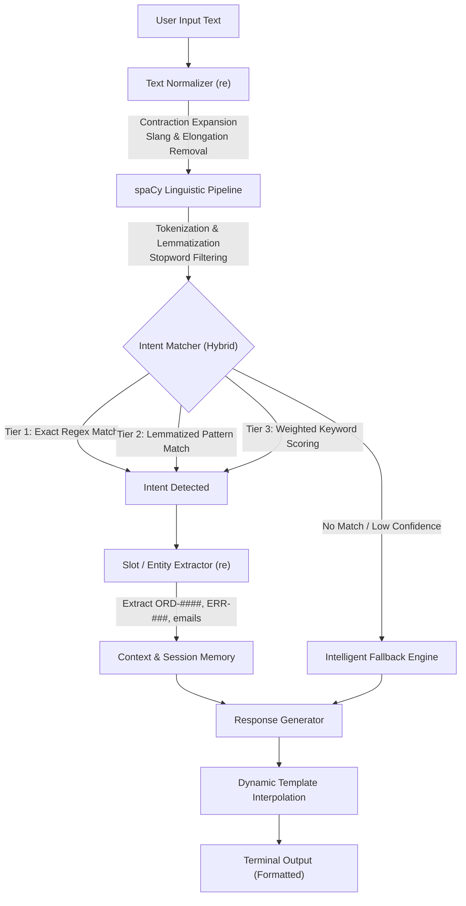

<div align="center">

# 🤖 Rule-Based Conversational Chatbot

### *An Intelligent, Terminal-Native Conversational AI Powered by Regex & spaCy NLP*

[](https://www.python.org/)
[](https://spacy.io/)
[](test_chatbot.py)
[](chatbot/engine.py)
[](LICENSE)

<br/>

[Key Features](#-key-features) •
[Architecture](#-architecture--pipeline) •
[Demo](#-sample-conversation) •
[Quick Start](#-quick-start) •
[CLI Options](#-usage--cli-options) •
[Knowledge Base](#-supported-topics--intents) •
[Extending Rules](#-adding-custom-rules)

---

</div>

## 📖 Overview

The **Rule-Based Conversational Chatbot** is a production-grade, terminal-native customer support assistant built purely in Python. Unlike black-box generative models, it delivers **deterministic, ultra-fast, and completely auditable** conversational handling without requiring paid API keys, GPU compute, or external cloud services.

By combining the precision of **Regular Expressions (`re`)** for exact phrasing, contraction expansion, and entity extraction with the linguistic power of **spaCy NLP (`en_core_web_sm`)** for tokenization, lemmatization, and stopword filtering, the chatbot accurately understands user intents across a wide range of natural language inputs.

---

## ✨ Key Features

- **⚡ Hybrid Intent Matching Engine**:
  Multi-tier matching hierarchy combining exact Regex patterns, lemmatized linguistic templates, and weighted keyword density scoring.
- **🔍 Intelligent Entity / Slot Extraction**:
  Extracts and retains structured user data on the fly (e.g., tracking numbers `ORD-#####`, error codes `ERR-###` / `0x####`, email addresses, and phone numbers).
- **🧠 Multi-Turn Memory & State Tracking**:
  Maintains conversational context across multiple turns, enabling follow-ups, topic history tracking, and dynamic slot interpolation.
- **🛡️ Robust Text Preprocessing**:
  Automatic contraction normalization (`won't` $\to$ `will not`), slang/elongation reduction (`pleaaase` $\to$ `please`), and punctuation normalization.
- **🎯 4 Knowledge Domains & 23+ Intents**:
  Pre-loaded with deep customer service rules for **Orders & Shipping**, **Technical Support**, **Billing & Accounts**, and **General FAQ**.
- **🧭 Multi-Tier Guided Fallbacks**:
  Never hits a dead end. When confidence is low, provides context-aware suggestions, topic overviews, and sample questions instead of generic error messages.
- **📊 Developer Debug Telemetry**:
  Built-in `--debug` flag that displays real-time matching scores, token lemmas, active slots, and intent confidence directly in the console.
- **🧪 100% Automated Test Coverage**:
  Includes a full unit testing suite (`test_chatbot.py`) verifying regex patterns, spaCy normalizations, context memory, and slot extraction.

---

## 🏗️ Architecture & Pipeline



### How `re` and `spacy` Work Together

| Component | Library Used | Purpose in Chatbot |
| :--- | :--- | :--- |
| **Contraction Normalization** | `re` (Regular Expressions) | Expands idioms and contractions (`i'm` $\to$ `i am`, `can't` $\to$ `cannot`, `what's` $\to$ `what is`). |
| **Elongation Cleaning** | `re` (Regular Expressions) | Collapses repeated characters and casual slang (`hiiiiii` $\to$ `hello`, `noooo` $\to$ `no`). |
| **Linguistic Lemmatization** | `spacy` (`en_core_web_sm`) | Reduces words to their base linguistic roots (`broken` $\to$ `break`, `pricing` $\to$ `price`, `delivered` $\to$ `deliver`). |
| **Stopword Filtering** | `spacy` (`en_core_web_sm`) | Removes grammatical noise tokens (`the`, `is`, `at`, `which`) to expose high-value semantic keywords. |
| **Slot & Entity Extraction** | `re` (Capture Groups) | Uses capture regex patterns to extract parameters like Order IDs (`ORD-\d{5}`), Error Codes (`ERR-\d{3}`), and contact details. |
| **Pattern Matching** | `re` + spaCy Lemmas | Matches complex sentence structures and intent rules with flexible boundaries (`\b`). |

---

## 📁 Repository Structure

```
Rule-Based Chatbot/
├── chatbot/
│   ├── __init__.py           # Package exports & public API
│   ├── context.py            # Multi-turn state, history, and slot memory store
│   ├── engine.py             # Hybrid rule matcher (Regex, keyword density, slots)
│   ├── normalizer.py         # NLP text cleaner using re & spacy
│   └── rules.py              # Knowledge base: 4 domains, 23 intents, responses & slots
├── cli.py                    # Terminal conversational interface with color support
├── main.py                   # Main universal entry point (CLI, debug, testing)
├── test_chatbot.py           # Comprehensive automated unit tests (15 test cases)
├── requirements.txt          # Project dependencies (spacy, colorama)
├── BEGINNER_GUIDE.md         # Educational walkthrough of NLP & rule-based concepts
└── README.md                 # Project documentation
```

---

## 🚀 Quick Start

### 1. Prerequisites
- **Python 3.9+** installed on your system. Verify with:
  ```bash
  python --version
  ```

### 2. Clone the Repository
```bash
git clone https://github.com/<your-username>/Rule-Based-Chatbot.git
cd Rule-Based-Chatbot
```

### 3. (Recommended) Create a Virtual Environment
```bash
# On Windows
python -m venv venv
.\venv\Scripts\activate

# On macOS / Linux
python3 -m venv venv
source venv/bin/activate
```

### 4. Install Dependencies & spaCy Model
```bash
pip install -r requirements.txt
python -m spacy download en_core_web_sm
```

### 5. Launch the Chatbot
```bash
python main.py
```

---

## ⚙️ Usage & CLI Options

The chatbot features a flexible command-line interface via [main.py](file:///c:/Users/indla/OneDrive/Desktop/Rule-Based%20Chatbot/main.py):

| Command | Description |
| :--- | :--- |
| `python main.py` | **Standard Mode**: Starts the clean, natural terminal chat interface. |
| `python main.py --debug` | **Developer Telemetry Mode**: Displays real-time matching logic, lemma tokens, slot captures, and keyword scores. |
| `python main.py --test` | **Test Runner**: Executes the complete 15-case automated test suite. |

---

## 💬 Sample Conversation

```text
============================================================
              RULE-BASED CONVERSATIONAL BOT
============================================================
(Type your message naturally. Type 'topics' to see topics, or 'exit' to quit.)

Bot: Hello! Welcome to our support desk. How can I help you today?

You: hey there, where is my order ORD-88192?
Bot: Checking shipment logs for you... Status for [ORD-88192]: Currently In Transit via FedEx Express (Estimated Delivery: Tomorrow by 4:00 PM). Standard deliveries typically arrive within 2-4 business days.

You: my wifi is broken and wont connect
Bot: Quick network troubleshooting: 1. Toggle Airplane Mode ON for 10 seconds, then OFF. 2. Restart your Wi-Fi router (power down for 30 seconds). 3. Forget the Wi-Fi network in Settings and re-enter the wireless security key.

You: I am getting ERR-404 on the app
Bot: Troubleshooting error [ERR-404]: 1. Force close the app and clear cache. 2. Verify that your device has an active internet connection. 3. Update the app to the latest release in your app store.

You: can i talk to a real person?
Bot: Transferring you to our Live Support Team... An agent will be with you in approximately 2 minutes. You can also reach our phone hotline at 1-800-555-0199 (Mon-Fri 8am-8pm EST).

You: exit
Bot: Goodbye! Have a wonderful day.
```

---

## 📚 Supported Topics & Intents

The knowledge base in [`chatbot/rules.py`](file:///c:/Users/indla/OneDrive/Desktop/Rule-Based%20Chatbot/chatbot/rules.py) covers **4 core business domains**:

### 1. 📦 Orders & Shipping
- **Track Order**: Automatic extraction and lookup for `ORD-#####` format.
- **Order Cancellation**: Policies, cutoff windows, and self-service cancellation steps.
- **Delivery Options**: Standard, Express, and Overnight options with transit estimates.
- **Returns & Refunds**: 30-day money-back guarantee, return label generation, and refund timelines.

### 2. 🛠️ Technical Support
- **Power & Hardware Issues**: Device won't boot, battery drainage, and reset cycles.
- **Wi-Fi & Connectivity**: Network troubleshooting, DNS resets, router cycling.
- **App Crashing & Errors**: Extracts error codes (`ERR-###`, `0x####`) with specific fix instructions.
- **Password Reset**: Self-service account recovery and security verification links.

### 3. 💳 Account & Billing
- **Pricing & Subscriptions**: Tier comparisons (Free, Pro, Enterprise) and features.
- **Payment Method Update**: Updating credit/debit cards, PayPal, and billing addresses.
- **Invoices & Receipts**: Downloading tax receipts and monthly statements.
- **Security & 2FA**: Setting up authenticator apps and SMS verification codes.

### 4. 💬 General FAQ & Small Talk
- **Store Hours & Locations**: Physical headquarters, operational hours, time zones.
- **Live Human Escalation**: Seamless handoff to human agents with phone hotline info.
- **Greetings & Pleasantries**: Natural responses to greetings, "how are you", and farewells.
- **Humor & Easter Eggs**: Tech jokes and casual conversation.

---

## 🧪 Testing & Verification

The project includes unit tests covering normalization, pattern matching, slot memory, and fallback behavior:

```bash
python main.py --test
# or
python -m unittest test_chatbot.py
```

### Test Suite Output:
```text
[*] Running Automated Test Suite...
test_compound_greeting_and_question ... ok
test_contraction_expansion ... ok
test_fallback_mechanism_unknown_input ... ok
test_greeting_variations ... ok
test_human_agent_escalation ... ok
test_multi_turn_context_and_memory ... ok
test_numeric_topic_selection ... ok
test_re_regex_elongations_and_cleaning ... ok
test_single_keyword_mapping ... ok
test_spacy_nlp_pipeline ... ok
test_topic_billing_subscriptions ... ok
test_topic_general_faq_and_joke ... ok
test_topic_orders_tracking ... ok
test_topic_tech_support_error_code_entity ... ok
test_topic_tech_support_power_issue ... ok

----------------------------------------------------------------------
Ran 15 tests in 1.114s

OK
```

---

## 🛠️ Adding Custom Rules

Adding new capabilities is straightforward. Open [`chatbot/rules.py`](file:///c:/Users/indla/OneDrive/Desktop/Rule-Based%20Chatbot/chatbot/rules.py) and add an intent dictionary:

```python
"warranty_inquiry": {
    "intent": "warranty_inquiry",
    "topic": "orders",
    "patterns": [
        r"\b(warranty|guarantee|coverage period)\b",
        r"\bhow long is the warranty\b"
    ],
    "keywords": {
        "warranty": 4.0,
        "guarantee": 3.0,
        "coverage": 2.0,
        "repair": 2.0
    },
    "responses": [
        "All our hardware products include a 1-year limited manufacturer warranty covering defects."
    ],
    "slots_required": []
}
```

Restart the chatbot or run `python main.py --test` to immediately see your new rule in action!

---

## 🎓 Learning More

Looking to learn how the underlying algorithms work?
Check out our detailed guide:
👉 **[Beginner's Guide to Rule-Based NLP & Regex](file:///c:/Users/indla/OneDrive/Desktop/Rule-Based%20Chatbot/BEGINNER_GUIDE.md)**

It covers:
- Core differences between Rule-Based systems and Generative LLMs
- Step-by-step regex tokenization & normalization mechanics
- Lemmatization vs. Stemming
- Weighted scoring algorithms & fallback tree design

---

## 📄 License

This project is licensed under the **MIT License** — feel free to use, modify, and distribute it for personal, academic, or commercial projects.

<div align="center">
⭐ If you found this project helpful, don't forget to star the repository! ⭐
</div>
